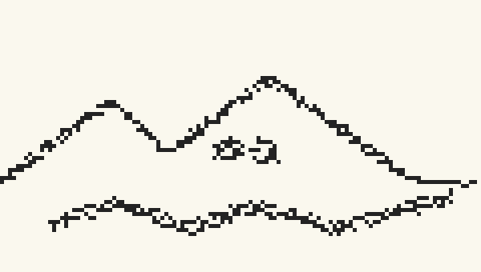
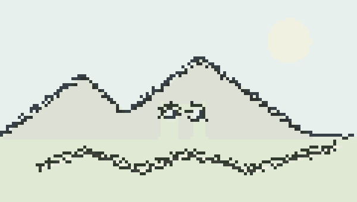

# Pixel Tracer for GIMP

Turn a photo into a deliberately imperfect, low-resolution drawing that looks
like it was made in classic MS Paint, then continue editing the PNG in GIMP.

The default `poster` style is tuned for character sheets and distressed anime-
poster references: it preserves the full image, reduces it to a compact color
palette, adds ordered screen dithering and grain, strengthens dark contours,
and applies a tiny RGB registration offset. This is a much better fit for
finished illustrations than the original contour-only mode.




The faint-underlay mode is useful when you want a guide while finishing the
piece in GIMP:



The output uses a small working canvas, limited palette, charcoal pixel ink,
nearest-neighbour scaling, and subtle stroke jitter. It is intentionally an
interpretation of hand tracing rather than a claim that an LLM physically drew
the image.

## Use

```bash
python3 pixel_tracer.py /path/to/source.jpg -o /path/to/trace.png --open-gimp
```

Or launch the small desktop picker:

```bash
python3 pixel_tracer_gui.py
```

The installed application is named **tracer** and is also available from the
KDE application menu under Graphics. Its workbench exposes every renderer
control: style, pixel width, palette size, edge threshold, hand wobble, seed,
RGB offset, grain, paper, ink, underlay, caption, output path, and whether to
open the result in GIMP. Its photo browser lists image files only and omits
hidden dotfiles. Live human-stroke playback draws the contour study in the
preview with ordered, slightly varied timing before the final poster render.
The interface uses a retro Macintosh layout with a Morrowind-inspired ash,
moss, bone, rust, and gold palette.

Useful controls:

```text
--width 120        stronger pixelation
--threshold 0.24  fewer, simpler contour lines
--jitter 0.8      more hand-like wobble
--underlay        retain a faint source-image guide beneath the ink
--seed 12         repeatable variation
--paper gray      use a gray Paint-like canvas
--ink navy        use navy pixel ink
--style trace     use the original contour-only renderer
--chroma 1        add one working-pixel RGB misregistration offset
--grain 0.10      increase photocopy/screen texture
--caption "... IT'S ALL OVER, ISN'T IT?"  add a black caption bar
```

For a reference like the supplied character poster, a good starting point is:

```bash
python3 pixel_tracer.py character.png -o character-poster.png \
  --width 180 --colors 16 --threshold 0.15 \
  --chroma 1 --grain 0.10 \
  --caption "... IT'S ALL OVER, ISN'T IT?" --open-gimp
```

The program does not require GIMP to generate the PNG. `--open-gimp` is an
optional convenience for systems where GIMP is installed. Install dependencies
with Pillow and NumPy available in the active Python environment.
